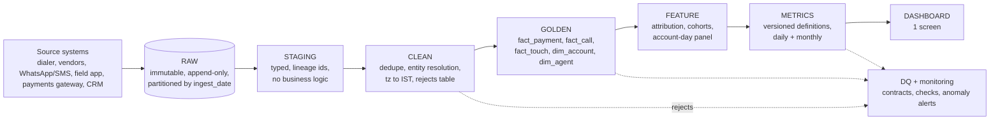

# Production analytics design (Part 5)

The prototype in this repo implements Raw → Staging → Clean → Golden → Metrics in DuckDB (`sql/00` to `sql/05`). The layout below is how an engineering team would run it daily.

## Layers

| Layer | Contents | Rule |
|---|---|---|
| **Raw** | Source files/CDC events exactly as received + `_ingested_at`, `_source_file`, `_batch_id` | Never updated. A schema change adds columns; nothing is rewritten. Overwritten source history (e.g. status history) is preserved here |
| **Staging** | Typed copy, `_raw_row` lineage id, source schema version | No logic; re-runnable |
| **Clean** | Dedupe, entity resolution, IST normalisation, normalised codes | Every dropped row goes to `clean.rejects(src, key, reason, _raw_row)` |
| **Golden** | One row per business event with trusted dimensions | The only layer analysts query |
| **Feature** | Touch→payment attribution (windowed), account-day panel, cohort tables | Derived from golden only |
| **Metrics** | One table per metric family, with a version | Metric code is reviewed like application code |
| **Dashboard** | Reads metrics only | No logic in the BI tool |

## Data contracts (per source; enforced at Raw→Staging)
Each contract is a YAML file checked into the repo: owner, schema (name, type, nullable), primary key, allowed values, freshness SLA, and a **breaking-change policy** (producers must announce a new `schema_version`/`disposition_version` before use; unknown codes quarantine the row instead of failing the pipeline).

| Table | Primary key | Grain | Freshness | Key contract checks |
|---|---|---|---|---|
| payments | `payment_id` | one payment event | 30 min | status ∈ {SUCCESS, FAILED, PENDING, REVERSED}; amount > 0; `account_id` ∈ accounts |
| calls | `call_id` | one call | 30 min | status ∈ allowed set; `account_id` ∈ accounts; `timezone` ∈ allowed set |
| call_attempts / dispositions | `attempt_id` / `disposition_id` | one row each | 30 min | `call_id` ∈ calls (**keys other than `call_id` are not trusted**) |
| accounts (SCD2 in production) | `account_id` + `valid_from` | account version | daily | `dpd` 0-999; `outstanding` ≥ 0 |
| agents (SCD2) | `agent_id` + `valid_from`; xref `employee_code` | agent version | daily | one active version per id |
| promises_to_pay | `ptp_id` | one promise | 1 h | `promised_date` ≥ `event_at` |
| campaigns | `campaign_id` | campaign | daily | **definition frozen at creation; edits create a new version** |

## Metric definitions and lineage
`docs/metric_definitions.md` is the specification; each metric lives in one SQL view with a header comment naming its inputs. Lineage is captured automatically from SQL (dbt `ref()`/column-level lineage or OpenLineage) so any dashboard number traces back to raw rows via `_raw_row`. The dashboard shows `metric_version` and `data_as_of`.

## Incremental processing
- Raw loads append by `_batch_id`; Clean/Golden models are **idempotent MERGEs on the primary key** with a **7-day lookback** on `event_at` and `_ingested_at` (late arrivals up to 7 days are absorbed automatically).
- Dedupe rule is deterministic (same ordering as `sql/02_clean.sql`), so reprocessing produces identical rows.
- Metrics recompute only for dates touched by a changed golden partition.

## Late-arriving data and backfills
- Anything older than the lookback goes to a `late_arrivals` queue and triggers a **partition-level backfill** of affected days plus dependent metrics, then an automatic restatement note on the dashboard ("Mar-14 restated +₹0.8 L").
- Full backfill = rerun from Raw for a date range with a pinned `code_version`; outputs are written to a shadow schema, diffed against current golden (row counts, ₹ totals), and swapped atomically.
- Historical overwrite (e.g. status history `recorded_at` < `event_at`) is handled by bi-temporal columns: `event_at` (business time) and `recorded_at` (system time).

## Data-quality checks (run in CI and after each load)
| Class | Examples | Action |
|---|---|---|
| Schema/contract | unknown column, new `disposition_version`, new `timezone` value | quarantine + alert owner |
| Uniqueness | `payment_id`, `call_id` unique in golden | **block** publish |
| Referential | payment/call `account_id` in accounts; orphan rate < 1% | warn > 1%, block > 5% |
| Reconciliation | golden SUCCESS ₹ = raw SUCCESS ₹ − rejected duplicates (exact) | **block** on mismatch |
| Distribution | contact rate, disposition-code mix, share PENDING, share missing `agent_id` | alert on drift |
| Time | no future timestamps; no day with 0 rows; partial-month flag correct | block/alert |
| Business | outbound calls outside 08:00-19:00 IST; PTP kept vs verified gap | report to compliance/ops |

## Monitoring and anomaly detection
- **Pipeline**: freshness lag per source, row-count vs 28-day same-weekday median, reject rate by reason, job duration.
- **Metrics**: daily net recovery **per calendar day**, contact rate, payment mix (SUCCESS/REVERSED/PENDING), duplicate rate. Detection is a robust z-score against the trailing 8 same-weekday values (median/MAD), calendar-aware so month length and weekends do not alarm. Alert at |z| > 3 for 2 consecutive days or any single day |z| > 5. Metric changes are shown with a 95% interval (daily CV ≈ 15%), so a single month is never reported as a trend.
- **Duplicate-payment alarm**: replay rate > 0.5% of daily rows pages the data engineer (the 2% seen here would trip it).
- **Statistical guard**: any "improvement" tile requires the CI to exclude 0 before it turns green.

## Serving and ownership
Dashboard served from the Metrics layer (BI tool or this repo's static page), refreshed hourly. Owners: ingestion (platform), clean/golden (data engineering), metrics (analytics, reviewed by finance and ops). An experiment registry (account-level holdout flags in `fact_touch`) is part of Feature so every future lift number is measured, not modelled.
